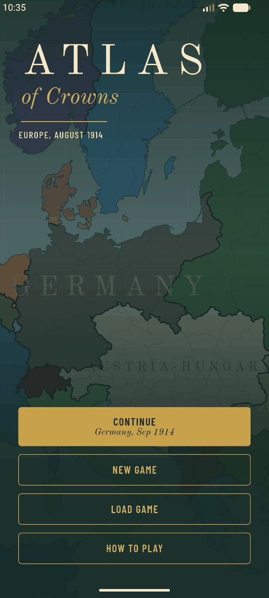
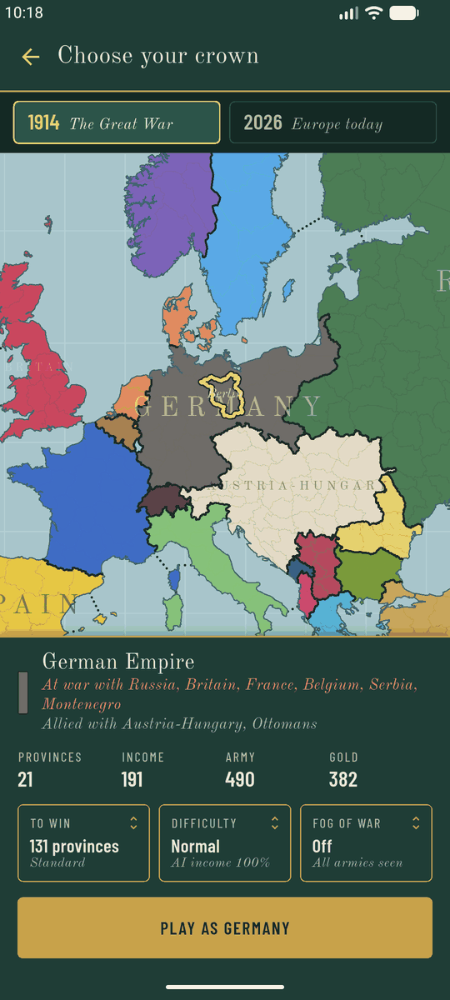
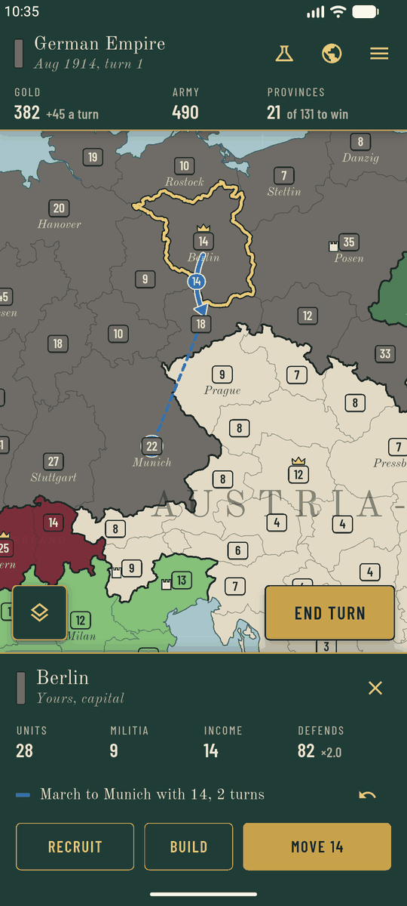
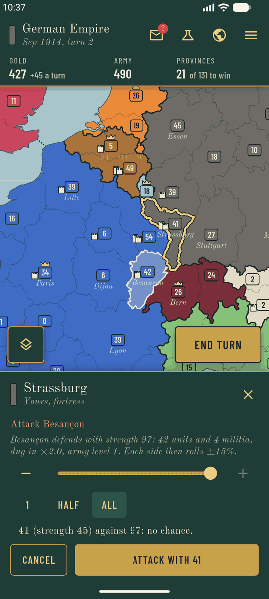
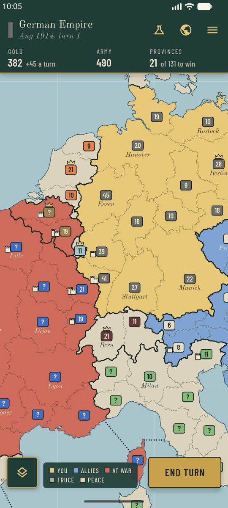
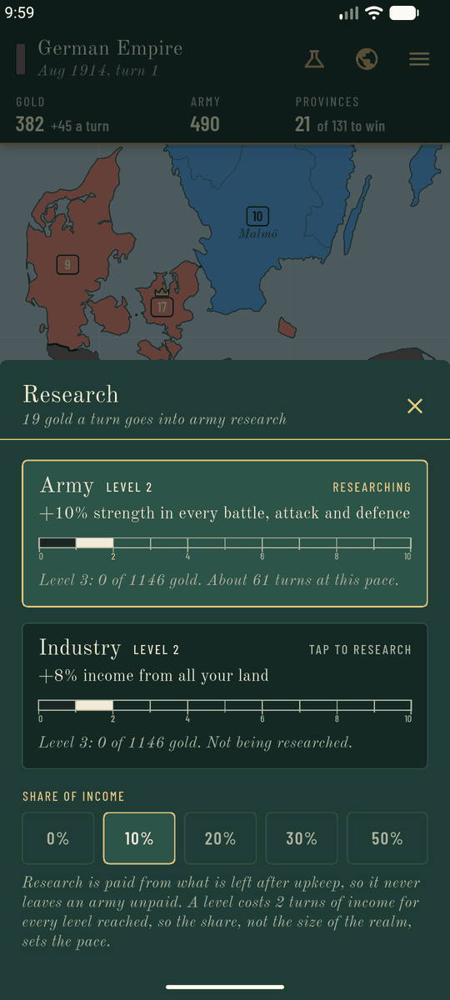

# Atlas of Crowns

A turn-based grand strategy game for Android phones, played on a map of
Europe and the Mediterranean. Start in August 1914 with the Great War under
way, or in today's Europe at peace. Choose a nation, raise armies, build
forts, research, make alliances, march across 327 provinces and hold enough
of the map to win. Every other nation is played by the AI, and all of them
move at the same moment when the turn ends.

<p>
  
  
  
</p>
<p>
  
  
  
</p>

## Contents

- [Features](#features)
- [Install](#install)
- [How to play](#how-to-play)
- [Build from source](#build-from-source)
- [Project layout](#project-layout)
- [Working on the code](#working-on-the-code)
- [Rebuilding the map](#rebuilding-the-map)
- [Releases and versioning](#releases-and-versioning)
- [Release signing](#release-signing)
- [Contributing](#contributing)
- [Credits and licence](#credits-and-licence)

## Features

- **A real map.** 327 provinces cut from Natural Earth data and redrawn to
  the borders of 1914: Alsace-Lorraine is German, Galicia is Austrian,
  Congress Poland is Russian, Libya is Italian.
- **Two scenarios on it.** *The Great War* opens in August 1914 with 23
  nations, the wars of that month already declared, the Entente and the
  Central Powers bound by treaty and the great fortresses manned. *Europe
  today* opens in January 2026 with 58 nations at peace, NATO bound together
  and the AI slow to start wars: the player sets the pace.
- **History, if it still fits.** In 1914 the Ottomans, Italy, Bulgaria,
  Romania and Greece enter the war in the months they did, as long as the
  game still looks enough like history for it to make sense. A player's
  nation is never pushed into a war; it is offered the alliance instead.
- **Simultaneous turns.** Everyone's orders resolve at once. Reinforcements
  arrive before attacks, and an army that marches away no longer defends.
- **Alliances.** Propose one, accept one, leave one. Declare war on a nation
  and its allies declare war on you in the same turn.
- **Forts and development.** Build a fort or a fortress in a province, or
  develop it for more income.
- **Research.** Put a share of the income into army technology (every unit
  fights harder) or industry (every province yields more).
- **Conquest has a price.** Taken land yields half its income at first and
  may revolt while its garrison is weak, back to its old owner or as a
  fallen nation risen again.
- **Long marches.** Send an army to any of your provinces, however far; it
  walks there on its own, one province a turn.
- **Map modes.** Political, diplomatic (allies, enemies, truces) and economic.
- **Your game, your rules.** Three lengths, three difficulties (the AI earns
  80%, 100% or 125%), fog of war on or off.
- **An AI for every nation.** It holds its fronts, attacks what it can
  overwhelm, gathers its army when it cannot, seeks allies against a shared
  threat, garrisons its conquests, builds, researches, sues for peace when a
  war goes nowhere and grows bolder the longer it sits idle.
- **Readable combat.** The sheet shows what a province defends with and the
  odds of the attack you are about to order.
- **Saves.** The game saves itself every turn; manual saves on top.
- **Built for one hand.** Portrait only, map edge to edge, End turn under the
  right thumb.

Not in the game yet: navies and sea zones, peace terms beyond the front line,
vassals, sound, other maps.

## Install

Download the latest `AtlasOfCrowns-v*.apk` from the
[Releases](../../releases/latest) page and open it on an Android phone
(Android 7.0 or newer). The phone will ask once for permission to install
apps from your browser or file manager.

Every release is signed with the same key, so a newer one installs over an
older one and keeps your saved games.

## How to play

1. **Pick a scenario and a nation** by tapping it on the map, set the length,
   difficulty and fog of war, and start.
2. **Give orders.** Tap one of your provinces to recruit, build or move its
   units: to a neighbouring province, or to any province of yours further off
   for a march of several turns. Moving into a province of a nation you are
   at war with is an attack. Blue arrows are marches, red arrows attacks.
   Tap a foreign province for diplomacy. The flask opens research, the globe
   the list of powers, the layers button the map modes.
3. **End the turn.** All nations move at once, battles are fought, and the
   dispatches tell you what happened.

| Rule | In short |
|---|---|
| Recruiting | 4 gold per unit. A province raises up to 2 plus its income each turn. New units defend at once and march from the next turn. |
| Upkeep | Every 4 units cost 1 gold a turn. An empty treasury makes units desert. |
| Movement | One province a turn, across a border or a strait marked with a dotted line. |
| Battle | Attackers must beat the defenders plus the province's militia, multiplied by 1.5 for being dug in, 0.5 more per fort level and 0.5 more in a capital. Army technology adds 5% per level to either side. Each side then rolls 15% up or down. The loser is destroyed. |
| Diplomacy | Tap a foreign province to declare war on its owner; the border opens the turn after, and the owner's allies join at once. Peace needs both sides and is followed by a truce of 8 turns. An alliance needs both sides too. |
| Building | One project per province a turn. A fort level costs 40 gold times the level and 1 gold a turn; a province falls with one level less. Development adds 1 income for 20 gold, 15 more for each further level, up to 5. |
| Research | A share of income (0 to 50%) goes into army or industry. A level costs 2 turns of income times the level reached. Army: +5% strength a level. Industry: +4% income a level. |
| Conquest | Land taken from its owner at the start yields 50% of its income, rising to all of it over 24 turns. Until then, held with fewer units than its militia, it may revolt. |
| Winning | Hold the chosen share of all provinces. Lose your last province and the game is over. |

The same rules are in the game under **How to play**.

## Build from source

### What you need

| Tool | Version | Needed for |
|---|---|---|
| [Flutter](https://docs.flutter.dev/get-started/install) | 3.47 or newer (Dart 3.13) | everything |
| Android SDK | platform 36, build-tools 36 | building and running |
| JDK | 17 or newer (21 is what CI uses) | the Android build |
| Git | any recent | getting the code |
| Node.js | 20 or newer | only to rebuild the map |
| Python + Pillow | 3.10 or newer | only to redraw the launcher icon |

Android Studio installs the SDK, a JDK and an emulator in one go. Run
`flutter doctor` afterwards and fix what it reports.

### First run

```sh
git clone <repository-url> atlasofcrowns
cd atlasofcrowns
flutter pub get
flutter test          # under a minute; plays eight 300-turn AI games among other things
flutter run           # on a connected phone or a running emulator
```

That is all. The map and scenario are checked in under `assets/`, so Node is
not needed to build the app, and no signing key is needed either: a clone
without one signs release builds with the debug key (see
[Release signing](#release-signing)).

To produce an APK:

```sh
flutter build apk --release
# build/app/outputs/flutter-apk/app-release.apk
```

### Handy tools

| Command | What it does |
|---|---|
| `flutter analyze` | Static analysis. Must report no issues. |
| `flutter test` | Rules, saves, map geometry, camera, UI flows, headless games. |
| `dart run tool/sim.dart 300 1` | Plays AI against AI for 300 turns with seed 1 and prints the standings. Use it to judge a balance change. Further arguments: win share, report interval, scenario (`dart run tool/sim.dart 300 1 0.95 25 modern`). |
| `tool/emu.sh install release` | Builds the APK and installs it over adb. |
| `tool/emu.sh start` / `shot f.png` / `tap x y` / `log` | Drives the installed app on an emulator or phone. Run `tool/emu.sh` alone for the full list. |

`tool/emu.sh` is a Bash script; on Windows run it from Git Bash.

## Project layout

```
lib/
  engine/     The rules, in plain Dart. No Flutter imports.
    world.dart      static data: provinces, nations, the scenario
    state.dart      everything that changes; a save file is this as JSON
    orders.dart     what a nation asks for in one turn
    resolve.dart    resolves one turn for every nation at once
    ai.dart         plans a turn for an AI nation
    game.dart       world + state, and the questions the UI and the AI ask
    rules.dart      every tunable number of the game
    rng.dart        seeded random numbers; the state is saved with the game
  map/        Province geometry, camera (pan and zoom), painters, MapView
  game/       GameController: the player's orders, selection and input mode
  data/       Asset loading and the save files
  ui/         Screens and sheets
  theme.dart  Colours, fonts and text styles
assets/
  map/europe.json         province shapes and adjacency                 (generated)
  scenarios/1914.json     The Great War: nations, owners, income, wars,
                          alliances, forts, technology, history          (generated)
  scenarios/modern.json   Europe today, on the same provinces            (generated)
  scenarios/index.json    the scenarios the game offers, in order        (generated)
  fonts/                  Old Standard, Barlow Condensed
tool/
  map/        Node pipeline that generates the JSON files above
  ci/         version numbering for releases
  icon/       draws the launcher icon
  sim.dart    headless balance runs
  emu.sh      build, install and drive the app over adb
test/
  engine/     rules, determinism, headless games
  app/        geometry, camera, controller, saves, widget flows
.github/workflows/
  release.yml   every push to main becomes a signed release
  checks.yml    analysis and tests on every pull request
```

## Working on the code

Four rules keep the game testable. A change that breaks one of them will
break a test.

1. **The engine stays pure.** Nothing in `lib/engine` imports Flutter or
   `dart:ui`. That is what lets a whole game run in a unit test.
2. **The engine is deterministic.** The same seed and the same orders give
   the same game. All randomness goes through the `Rng` passed down from
   `Game.endTurn`; never use `dart:math`'s `Random` or the clock there, and
   sort before iterating a `Set` or `Map` when the order affects the result.
3. **Orders are requests.** The resolver checks every order against the rules
   and drops what is not allowed. The UI may check first, but the engine
   never trusts it.
4. **Saves must keep loading.** A new field in `GameState` needs a default in
   `GameState.fromJson`, and a new field in `Orders` one in `Orders.fromJson`.

Where to make common changes:

| To change | Look at |
|---|---|
| A number: costs, combat bonus, truce length, AI caution | `lib/engine/rules.dart` |
| How a turn resolves | `lib/engine/resolve.dart`, tests in `test/engine/resolve_test.dart` |
| How the AI plays | `lib/engine/ai.dart`, then `dart run tool/sim.dart` over several seeds |
| Who owns what in 1914, province names, colours, starting wars and alliances, forts, technology, history, sea links | `tool/map/config/scenario_1914.mjs`, then rebuild the map |
| Europe today: nations, colours, alliances, development, names | `tool/map/config/scenario_modern.mjs`, then rebuild the map |
| How the map is drawn | `lib/map/map_painters.dart`, `lib/map/map_scene.dart` |
| A screen or sheet | `lib/ui/` |
| Colours and type | `lib/theme.dart` |

After a change to rules or AI, run a few seeds of
`dart run tool/sim.dart 300 <seed> 0.95` and check that the game still moves:
the test suite fails if nothing changes hands for 60 turns.

After a change to the UI, look at it on a device. `adb` cannot pinch, so
zooming is covered by a widget test instead.

## Rebuilding the map

Only needed when changing borders, merges, names or the scenario.

```sh
cd tool/map
npm install
```

Download two datasets from
[Natural Earth](https://www.naturalearthdata.com/downloads/10m-cultural-vectors/)
(or directly from `https://naciscdn.org/naturalearth/10m/cultural/`) and unzip
each into its own folder:

| Dataset | Unzip into |
|---|---|
| `ne_10m_admin_1_states_provinces.zip` | `tool/map/raw/admin1/` |
| `ne_10m_populated_places_simple.zip` | `tool/map/raw/places/` |

Then:

```sh
node build_map.mjs            # add --fresh after changing the map window
```

The script clips the data to the game window, assigns every unit its 1914
owner, merges about two thousand units into 327 provinces, never across a
1914 border and, but for a few small territories, never across a modern one,
simplifies the outlines, works out adjacency, and writes
`assets/map/europe.json`, `assets/scenarios/1914.json` and
`assets/scenarios/modern.json`. So today's borders fit the same provinces; the
few provinces that mix two countries at this scale are assigned by hand in
the modern config. It also renders
previews and province lists to `tool/map/out/`; look at them before
committing.

Province ids are positions in the generated file. Changing how provinces are
merged changes the map's build id, and saves made on the old map are then
refused rather than loaded wrongly.

## Releases and versioning

Every push to `main` is published automatically by
[`.github/workflows/release.yml`](.github/workflows/release.yml):

1. analysis and the full test suite run; a failure stops the release;
2. the next version is worked out;
3. the APK is built with that version and signed with the release key;
4. a GitHub release named **Atlas of Crowns v1.4** (for example) is created
   with `AtlasOfCrowns-v1.4.apk` attached and notes generated from the
   commits.

Versions have the form `v<major>.<n>`:

- `<major>` is the first number of `version:` in `pubspec.yaml`. It is the
  only number set by hand. Raise it to start a new line: `2.0.0` makes the
  next release `v2.0`.
- `<n>` is one more than the highest existing `v<major>.<n>` tag, starting at
  0. The first release is `v1.0`, the next `v1.1`, then `v1.2`, and so on.

No version is ever reused. Releases are published one at a time, and the
workflow fails rather than touch a release that already exists. Each build
also gets an Android version code (`major x 10000 + n`) that only grows, so a
phone always accepts a newer release over an older one and never the reverse.

Nothing is committed back to the repository, so your local branch never falls
behind because of a release.

Before the first push, add the two secrets described below, or the workflow
stops at "Restore the signing key".

## Release signing

Android only installs an update over an app that was signed with the same
key. The project therefore has one release key, and it is deliberately **not**
in the repository.

Two files, both in the project root next to `pubspec.yaml`, both ignored by
git:

| File | What it is |
|---|---|
| `atlasofcrowns-release.jks` | the keystore holding the key (alias `atlasofcrowns`) |
| `key.properties` | the keystore's password and alias, read by `android/app/build.gradle.kts` |

When both are present, `flutter build apk --release` signs with the release
key. When they are absent, as in any fresh clone, the release build falls
back to the debug key: the app runs normally, but it cannot be installed over
an official release (uninstall that first).

### For contributors

You do not need the key. Build, run and test as described above. Official
releases are signed by the workflow.

### For the maintainer

**Back the two files up now**, somewhere that is not this repository: a
password manager that stores attachments, an encrypted drive, an offline USB
stick. If they are lost, no future version can update the app on anyone's
phone; if they leak, anyone can publish an "update" in the project's name.

**To build signed releases on another machine,** copy both files into the
project root there. Nothing else has to be configured. To confirm the key
arrived intact, compare its fingerprint with the one in the workflow file:

```sh
keytool -list -v -keystore atlasofcrowns-release.jks -alias atlasofcrowns
# SHA256 must read 9A:DA:F7:E2:C2:28:13:83:64:6B:E9:5E:4E:D8:D4:58:84:E1:8C:F0:2F:31:1B:21:44:0B:30:1E:D1:66:49:22
```

**To let GitHub sign releases,** add two repository secrets under
*Settings > Secrets and variables > Actions*:

| Secret | Value |
|---|---|
| `KEYSTORE_BASE64` | the keystore file, base64-encoded on one line |
| `KEYSTORE_PASSWORD` | the value of `storePassword` in `key.properties` |

From Git Bash in the project root, this puts the first value on the
clipboard:

```sh
base64 -w0 atlasofcrowns-release.jks | clip      # macOS: base64 -i ... | pbcopy   Linux: ... | xclip -sel clip
```

Or, with the [GitHub CLI](https://cli.github.com/), set both without copying
anything by hand:

```sh
base64 -w0 atlasofcrowns-release.jks | gh secret set KEYSTORE_BASE64
sed -n 's/^storePassword=//p' key.properties | tr -d '\n' | gh secret set KEYSTORE_PASSWORD
```

The workflow checks the keystore's fingerprint before building and refuses a
key that is not the release key.

## Contributing

Changes are welcome: new scenarios, rules, a smarter AI, interface work.

1. Fork the repository and create a branch from `main`.
2. Make the change. Add or update tests for anything in `lib/engine`.
3. Run `flutter analyze` and `flutter test`; both must pass. For rules or AI
   changes, include what `tool/sim.dart` showed before and after.
4. Open a pull request that says what changed and why. The same checks run
   there automatically.

Keep to the four rules under [Working on the code](#working-on-the-code),
match the style of the code around your change, and keep generated files
(`assets/map`, `assets/scenarios`) in the same commit as the configuration
change that produced them.

For anything large, such as navies, a new map or a new subsystem, open an
issue first so the design can be agreed before the work is done.

## Credits and licence

- Map data: [Natural Earth](https://www.naturalearthdata.com/), public domain.
- Fonts: [Old Standard](https://fonts.google.com/specimen/Old+Standard+TT) and
  [Barlow Condensed](https://fonts.google.com/specimen/Barlow+Condensed), SIL
  Open Font License 1.1. The licence texts are in `assets/fonts/`.
- Built with [Flutter](https://flutter.dev/).

The project's own code does not carry a licence yet. Until one is added, the
usual copyright rules apply: you may read and fork it on GitHub, but other
uses need the author's permission.
